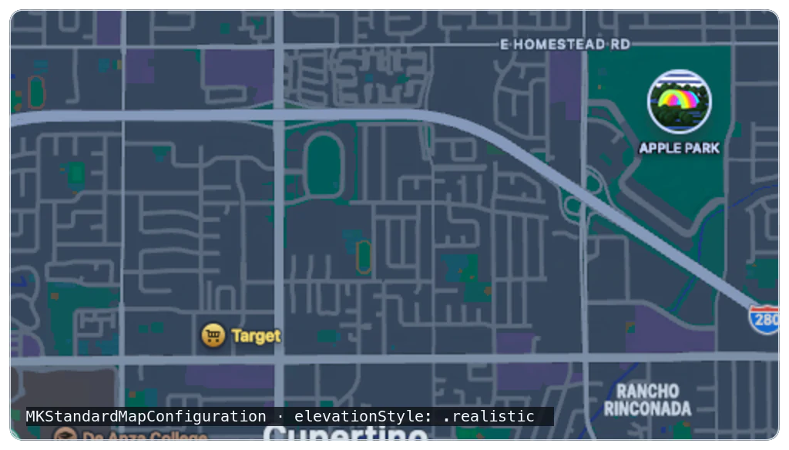

# mapkit_flutter

[](https://pub.dev/packages/mapkit_flutter)
[](https://pub.dev/packages/mapkit_flutter/score)
[](https://github.com/esenmx/mapkit_flutter/actions/workflows/ci.yaml)
[](LICENSE)

Apple Maps in your Flutter app on iOS and macOS. `mapkit_flutter` shows Apple's
own `MKMapView` as a widget — no API key, no bundled third-party SDK, Apple's
exact MapKit symbol names, and declarative sets diffed natively.



## Quick start

```bash
flutter pub add mapkit_flutter material_ui
```

Your app must target at least **iOS 17** and **macOS 14**, higher than Flutter's
defaults ([Setup](doc/setup.md#requirements) shows where). Building `MKMapView`
on Android or web throws `MapKitUnsupportedPlatformException`.

```dart
import 'package:mapkit_flutter/mapkit_flutter.dart';
import 'package:material_ui/material_ui.dart';

void main() {
  runApp(
    MaterialApp(
      home: MKMapView(
        initialCamera: MKMapCamera(
          centerCoordinate: CLLocationCoordinate2D(
            latitude: 37.334922,
            longitude: -122.009033,
          ),
          distance: 1500, // meters from the camera to the center
        ),
      ),
    ),
  );
}
```

## What's included

- **Map styles & controls.** `MKStandardMapConfiguration` (with realistic 3D
  elevation), `MKHybridMapConfiguration`, `MKImageryMapConfiguration`, POI
  filtering, traffic, compass/scale, and user tracking.
- **Declarative pins & clustering.** `MKPointAnnotation` with system balloon
  markers, SF Symbol glyphs, custom images, callout/selection/drag callbacks,
  and native `clusteringIdentifier` grouping.
- **Vector & tile overlays.** `MKPolyline` (including geodesic and gradient
  strokes), `MKPolygon` with holes, `MKCircle`, and `MKTileOverlay` with
  snapshot compositing.
- **Mockable controller.** `MKMapViewController` interface for camera/region,
  coordinate conversions, snapshots, and iOS Look Around.
- **Optional `CameraConveniences`.** `zoomTo`, `zoomBy`, `scrollBy`, and
  `fitCoordinates` layered over the canonical MapKit API.
- **Loud failures.** Invalid bounds, iOS-only props on macOS, and callbacks
  missing their opt-in flag throw in every build mode.

## Guides

- [Setup and platform differences](doc/setup.md) — iOS 17 / macOS 14 deployment
  targets, location permissions, and the iOS vs macOS support matrix.
- [Map style, annotations and overlays](doc/map-and-overlays.md) — full stateful
  page example, value validation & declarative diffing, controls, markers,
  shapes, and tile overlays.
- [Controller, helpers and errors](doc/controller-and-errors.md) —
  `MKMapViewController` reference, mockito unit testing, `CameraConveniences`,
  error types & `MapKitPlatformException` codes, and Pigeon bindings.

## Agent skill

This package ships an agent skill in `skills/mapkit-flutter-scaffold/`. Install
it into your project's agent config with:

```sh
dart run skills@ get --package mapkit_flutter --all
```

## Contributing

See [CONTRIBUTING.md](CONTRIBUTING.md).

## License

MIT — see [`LICENSE`](LICENSE).
